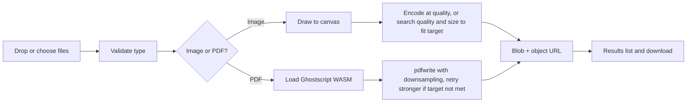

# FileForge

**Compress images and PDFs in your browser. Nothing is uploaded.**

FileForge is a client-side React web app that reduces the size of JPG/PNG/WebP images and PDF files. You can pick quality settings or type the size you want (for example, "200 KB"), and the app tries to hit it. All processing runs locally in the browser.

- **Live demo:** TODO (add URL if deployed)
- **Repository:** TODO (add URL)
- **Status:** TODO (for example, "Hackathon prototype")

## Preview

TODO: add screenshots to `docs/screenshots/` and link them here. The most useful ones would be:

1. The image compressor with the "Compress to" field filled in.
2. The results list showing original size, compressed size and percentage saved.
3. The PDF compressor page.

```md

```

## Overview

FileForge has two tools:

- **Image compressor** re-encodes JPG, PNG and WebP images with adjustable quality, output format and maximum width.
- **PDF compressor** recompresses the images embedded in PDFs using Ghostscript compiled to WebAssembly. Text and vector graphics are kept as they are.

Both tools accept multiple files, let you set a target file size, and show per-file and total savings. It is built for anyone who needs to meet an upload size limit (forms, email attachments, portals) without sending files to a third-party server.

## Problem Statement

Many websites and email systems cap upload sizes. Most online compressors work by uploading your file to a server, which is a concern for documents like IDs, contracts or certificates. Browser-based tools avoid that, but many of them rasterize PDFs, which makes text unselectable.

## Solution and Approach

| Need | How FileForge handles it |
|---|---|
| Keep files private | Processing runs entirely in the browser (Canvas API and WebAssembly). The app makes no upload requests. |
| Meet an exact size limit | A "Compress to" field accepts a size in KB or MB. The app searches for settings that fit under it. |
| Keep PDF text sharp | Ghostscript's `pdfwrite` device downsamples images and subsets fonts, so text and vectors are not rasterized. |
| Easy to use | Drag-and-drop, multi-file queue, presets for PDF, clear "Target not reached" feedback. |

## Key Features

### Image compression
- Formats in: JPG, PNG, WebP. Formats out: WebP, JPEG, PNG.
- Adjustable quality slider (lossy formats only; PNG is lossless, so the slider is disabled).
- Optional maximum width (2560 to 800 px), aspect ratio preserved.
- Target size: lowers quality first (binary search), then shrinks dimensions in steps until the file fits.
- If re-encoding would make a file larger (same format, no resize), the original is kept.

### PDF compression
- Three presets: Smallest, Balanced, Best quality, mapped to Ghostscript `/screen`, `/ebook` and `/printer` with matching image DPI.
- Target size: retries with progressively stronger image downsampling until the file fits.
- Never returns a file larger than the original.
- Page count is read with `pdf-lib`.

### General
- Multi-file queue with duplicate detection, per-file remove and "Clear all".
- Results list with size before and after, percentage saved and download button.
- Light and dark theme, saved in `localStorage` and defaulting to the system preference.
- Lazy-loaded routes, so the Ghostscript WASM code is only fetched when the PDF page is used.
- Per-page document titles and a 404 page.

## How It Works



**Image path:** the file is loaded into an ``, drawn onto a canvas and re-encoded with `canvas.toBlob`. With a target size, the app first tests the lowest quality at the current dimensions. If that fits, it binary-searches for the highest quality that still fits. If not, it scales dimensions by 0.85 per attempt (up to 10 attempts).

**PDF path:** the file is written into Ghostscript's in-memory file system and processed with `pdfwrite`. With a target size, up to five passes run (the chosen preset, then 96, 72, 50 and 36 DPI) and stop at the first result that fits.

## Technology Stack

| Technology | Purpose | Where or how it is used |
|---|---|---|
| React | UI library | All pages and components |
| Vite | Dev server and bundler | `npm run dev` / `npm run build`, WASM URL import (`?url`) |
| React Router (`react-router-dom`) | Routing | `AppRoutes.jsx`: `/image-compressor`, `/pdf-compressor`, 404, lazy loading |
| Tailwind CSS (`@tailwindcss/vite`) | Styling | Utility classes, plus CSS variables in `index.css` for theming |
| lucide-react | Icons | Navbar, drop zone, results list |
| Canvas API (browser) | Image re-encoding | `imageCompressorUtils.js` |
| `@jspawn/ghostscript-wasm` | PDF compression | `pdfCompressorUtils.js`, runs Ghostscript in WebAssembly |
| `pdf-lib` | PDF reading | Reads the page count of the output file only |

## Project Structure

```
fileforge/
├── index.html                 # Sets the saved theme before first paint
├── vite.config.js             # React + Tailwind plugins; excludes Ghostscript from pre-bundling
└── src/
    ├── main.jsx               # Entry point, BrowserRouter
    ├── App.jsx                # Theme state (localStorage + system preference)
    ├── index.css              # Tailwind import, theme variables, shared classes
    ├── routes/AppRoutes.jsx   # Layout, lazy routes, redirect from "/"
    ├── hooks/usePageTitle.js  # Per-page document title
    ├── utils/
    │   ├── fileUtils.js              # File type checks, formatBytes, saved percent
    │   ├── imageCompressorUtils.js   # Canvas compression and target-size search
    │   └── pdfCompressorUtils.js     # Ghostscript WASM compression and retries
    ├── components/            # Navbar, Hero, DropZone, SelectedFiles, Segmented,
    │                          # TargetSize, Stats, ResultsTable
    └── pages/                 # ImageCompressor, PdfCompressor, NotFound
```

## Getting Started

### Prerequisites
- Node.js (a current LTS version) and npm
- A modern browser with WebAssembly support

No environment variables or external services are required.

### Installation

```bash
git clone TODO-REPO-URL
cd fileforge   # or your project folder name
npm install
```

### Run

```bash
npm run dev
```

Then open the URL Vite prints (usually `http://localhost:5173`).

### Build

```bash
npm run build
npm run preview
```

Scripts come from the standard Vite React template. Check the `scripts` section of your `package.json` if yours differs.

## Usage

1. Open **Images** or **PDF** from the navbar.
2. Drop files onto the drop zone, or click it to choose files.
3. *(Optional)* Enter a size in **Compress to** (for example `200` and `KB`). Leave it empty to use the quality settings instead.
4. Click **Compress**. You can also press Enter in the form.
5. Download each result from the results list.

When a size is set, the image quality slider and PDF presets are ignored, because the app chooses settings itself.

## Security and Privacy

- Files are read and processed in the browser. The app contains no upload code and no backend.
- Output files are held as in-memory blobs and released with `URL.revokeObjectURL` when removed or reset.
- Password-protected PDFs are not supported.
- The only data stored is the theme choice (`localStorage`).
- This is a client-side tool and has not been through a formal security review.

## Technical Decisions

- **Ghostscript instead of `pdf-lib` for compression.** `pdf-lib` only rewrites the document structure and does not recompress images, so it cannot reduce size meaningfully. Ghostscript downsamples images and subsets fonts.
- **Not rasterizing PDFs.** Rendering pages to JPEG would shrink files more but would lose selectable text, links and vectors.
- **Fresh Ghostscript instance per pass.** The Emscripten runtime exits after `callMain`, so each pass creates a new instance.
- **Lazy loading.** Pages are code-split so the large WASM is only downloaded on the PDF page.
- **CSS variables for theming.** All colors live in `index.css`, so light and dark themes share the same markup.

## Limitations and Known Issues

- **PDF size targets are approximate.** Only embedded images are recompressed, so mostly-text PDFs may shrink little and show "Target not reached".
- **Ghostscript integration is unverified.** The import paths for `@jspawn/ghostscript-wasm` (`gs.wasm?url`, `createGs`) should be checked against the installed package version. TODO: confirm and update.
- **Large PDFs may freeze the page.** Compression runs on the main thread, not in a Web Worker.
- **Images are processed one at a time**, and metadata (such as EXIF) is dropped because images are re-encoded through a canvas.
- **Very small image targets** reduce pixel dimensions as well as quality.
- **Ghostscript is AGPL-licensed.** Review its license before distributing this project commercially.
- **No automated tests** exist yet.

## Future Improvements

- Move compression into a Web Worker to keep the UI responsive.
- Show per-file progress.
- Add "Download all as ZIP".
- Add before/after image preview.
- Add unit tests for the size-search logic and file helpers.

## Testing

There are no automated tests yet. The current checks are manual: compressing sample images and PDFs and inspecting the output sizes. Linting is available through the Vite template's ESLint setup, if present in your `package.json`.

## Deployment

The app is a static site. Run `npm run build` and host the `dist/` folder on any static host (Netlify, Vercel, GitHub Pages).

Because the app uses `BrowserRouter`, the host must serve `index.html` for unknown paths:

- **Netlify:** add `public/_redirects` containing `/* /index.html 200`
- **Vercel:** add `vercel.json` with `{ "rewrites": [{ "source": "/(.*)", "destination": "/" }] }`

## Contributing

1. Fork the repository and create a branch: `git checkout -b feature/my-change`
2. Make your changes and verify with `npm run dev` and `npm run build`.
3. Open a pull request describing the change.

## Acknowledgements

- [Ghostscript](https://www.ghostscript.com/) via [`@jspawn/ghostscript-wasm`](https://www.npmjs.com/package/@jspawn/ghostscript-wasm)
- [pdf-lib](https://pdf-lib.js.org/)
- [lucide](https://lucide.dev/) icons

## License

TODO: no license has been specified. Add a `LICENSE` file and name it here. If you ship Ghostscript, consider its AGPL terms when choosing.