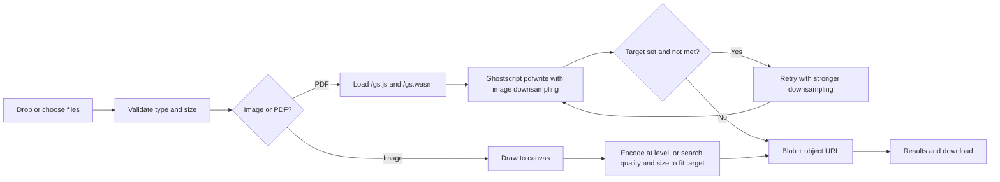

# FileForge

**Compress images and PDFs in your browser. Your files never leave your device.**

FileForge is a client-side React app that shrinks JPG, PNG and WebP images and PDF files. You can pick a compression level, or type the file size you want (for example "200 KB") and the app tries to hit it. All processing runs locally in the browser, with no backend and no uploads.

- **Live demo:** https://fileforge-self.vercel.app
- **Repository:** TODO (add URL)
- **Status:** TODO (for example, "Hackathon prototype")

## Preview

TODO: add screenshots to `docs/screenshots/` and link them here. The most useful ones:

1. The Home page with the two tool cards.
2. The Image Compress page with a file selected and a target size entered.
3. The Your Results section after compressing a PDF.
4. The dark theme.

```md


```

## Overview

FileForge has two tools:

| Tool | What it does |
|---|---|
| **Image Compress** | Re-encodes JPG, PNG and WebP images with a compression level, an optional target size and an output format. |
| **PDF Compress** | Recompresses images embedded in PDFs using Ghostscript compiled to WebAssembly. Text and vector graphics are kept as they are. |

Both tools accept multiple files, show the real before and after size for each result, and let you download each file separately. It is meant for anyone who needs to fit a file under an upload limit (forms, email, portals) without sending it to a third-party server.

## Problem Statement

Many sites and email systems cap upload sizes. Most online compressors upload your file to a server, which is a concern for documents such as IDs, resumes and contracts. Some browser-based tools avoid the upload but flatten PDFs into images, which makes the text unselectable. FileForge processes files locally and does not flatten PDFs.

## Key Features

### Image Compress
- Input: JPG, PNG, WebP. Output: Keep Original, WebP, JPEG or PNG.
- Three compression levels: Low, Balanced, High (quality 40, 65 and 85).
- **Target size:** enter a size in KB or MB. The app lowers quality first (binary search), then shrinks dimensions in steps until the file fits.
- If re-encoding would make the file larger (same format, no resize), the original is kept.
- PNG is lossless, so quality settings do not shrink it. The UI suggests WebP instead.
- Files over 10 MB are skipped.

### PDF Compress
- Three levels: Basic, Balanced, Strong, mapped to Ghostscript `/printer`, `/ebook` and `/screen` presets with matching image DPI.
- **Target size:** retries with stronger image downsampling (up to 5 passes) until the file fits.
- Never returns a file larger than the original.
- Page count is read with `pdf-lib`.
- Files over 50 MB are skipped.

### General
- Drag and drop, click to browse, multi-file queue with duplicate detection.
- Results list with a download button, per-file remove, and "Compress Another File".
- Light and dark theme (sun/moon toggle), saved in `localStorage`, defaulting to the system preference.
- Lazy-loaded routes and per-page document titles.
- The Ghostscript engine is only downloaded when the PDF tool is used.

## How It Works



**Image path:** the file is loaded into an ``, drawn on a canvas and re-encoded with `canvas.toBlob`. With a target size, the app first tests the lowest quality at the current dimensions. If that fits, it binary-searches for the highest quality that still fits. If not, it scales dimensions by 0.85 per attempt (up to 10 attempts).

**PDF path:** `public/gs.js` is loaded with a script tag, and it exposes a global `Module` factory. Each pass creates a fresh Ghostscript instance (the Emscripten runtime exits after `callMain`), writes the PDF into its in-memory file system and runs `pdfwrite`. With a target size, the passes are the chosen preset, then 96, 72, 50 and 36 DPI, stopping at the first result that fits.

## Technology Stack

| Technology | Purpose | Where or how it is used |
|---|---|---|
| React | UI library | Pages and components |
| Vite | Dev server and bundler | `npm run dev` / `npm run build` |
| React Router (`react-router-dom`) | Routing | `AppRoutes.jsx`: `/`, `/image-compressor`, `/pdf-compressor`, 404, lazy loading |
| Tailwind CSS (`@tailwindcss/vite`) | Styling | Utility classes, plus CSS variables and shared classes in `index.css` |
| lucide-react | Icons | Navbar, drop zone, results |
| Canvas API (browser) | Image re-encoding | `imageCompressorUtils.js` |
| Ghostscript WASM (`@jspawn/ghostscript-wasm`) | PDF compression | `gs.js` and `gs.wasm` copied into `public/`, run by `pdfCompressorUtils.js` |
| `pdf-lib` | PDF reading | Reads the page count of the output file only |

## Project Structure

```
fileforge/
├── index.html                 # Applies saved theme before first paint
├── vite.config.js             # React + Tailwind plugins
├── vercel.json                # SPA rewrite (see Deployment)
├── public/
│   ├── gs.js                  # Ghostscript loader (from @jspawn/ghostscript-wasm)
│   └── gs.wasm                # Ghostscript WebAssembly binary
└── src/
    ├── main.jsx               # Entry point, BrowserRouter
    ├── App.jsx                # Theme state (localStorage + system preference)
    ├── index.css              # Tailwind import, theme variables, shared classes
    ├── routes/AppRoutes.jsx   # Layout, lazy routes
    ├── hooks/usePageTitle.js  # Per-page document title
    ├── utils/
    │   ├── fileUtils.js              # Type checks, formatBytes, saved percent
    │   ├── imageCompressorUtils.js   # Canvas compression and target-size search
    │   └── pdfCompressorUtils.js     # Ghostscript loading, passes and retries
    ├── components/            # Navbar, Logo, Illustrations, Hero, DropZone,
    │                          # SelectedFiles, Field, CompressionLevel,
    │                          # TargetSize, ResultsTable
    └── pages/                 # Home, ImageCompressor, PdfCompressor, NotFound
```

## Getting Started

### Prerequisites
- Node.js (current LTS) and npm
- A modern browser with WebAssembly support

No environment variables or external services are required.

### Installation

```bash
git clone TODO-REPO-URL
cd fileforge   # or your project folder name
npm install
```

### Ghostscript files

The PDF tool needs `gs.js` and `gs.wasm` in `public/`. They are copied from the npm package, and both must be committed to Git so deployments include them:

```bash
# macOS / Linux
cp node_modules/@jspawn/ghostscript-wasm/gs.js public/gs.js
cp node_modules/@jspawn/ghostscript-wasm/gs.wasm public/gs.wasm
```

```powershell
# Windows PowerShell
copy node_modules\@jspawn\ghostscript-wasm\gs.js public\gs.js
copy node_modules\@jspawn\ghostscript-wasm\gs.wasm public\gs.wasm
```

### Run

```bash
npm run dev
```

Open the URL Vite prints (usually `http://localhost:5173`).

### Build

```bash
npm run build
npm run preview
```

These scripts come from the standard Vite React template. Check your `package.json` if yours differs.

## Usage

1. Choose **Image Compress** or **PDF Compress** on the Home page.
2. Drop files onto the drop zone, or click it to browse.
3. Pick a **Compression Level**, or enter a **Target Size** (for example `200` KB). When a target size is set, the level is ignored.
4. Click **Compress**.
5. Download each file from **Your Results**.

## Security and Privacy

- Files are read and processed in the browser. The app has no upload code and no backend.
- Output files are held as in-memory blobs and released with `URL.revokeObjectURL` when removed or reset.
- Password-protected PDFs are not supported.
- The only stored data is the theme choice (`localStorage`).
- The app has not had a formal security review.

## Technical Decisions

- **Ghostscript instead of `pdf-lib` for compression.** `pdf-lib` only rewrites the document structure and does not recompress images.
- **No page rasterization.** Rendering PDF pages to JPEG would shrink files more, but would lose selectable text, links and vectors.
- **Engine loaded from `public/`.** The package's `gs.js` is a classic script that defines a global `Module` factory rather than an ES module, so it is loaded with a script tag instead of being bundled by Vite.
- **Fresh Ghostscript instance per pass.** The runtime exits after `callMain`.
- **CSS variables for theming.** All colors live in `index.css`, so light and dark themes share the same markup.

## Limitations and Known Issues

- **PDF size targets are approximate.** Only embedded images are recompressed, so mostly-text PDFs may shrink little and show "Target not reached".
- **Compression levels are nominal.** The percentages on the level buttons (for example "−50%") are rough guides. Real savings depend on the file, and the results list shows the actual figure.
- **Large PDFs may freeze the page.** Compression runs on the main thread, not in a Web Worker.
- **Images are processed one at a time.** EXIF metadata is dropped because images are re-encoded through a canvas.
- **Very small image targets** reduce pixel dimensions as well as quality.
- **File size limits** (10 MB images, 50 MB PDFs) are enforced in the browser UI only.
- **Ghostscript is AGPL-licensed.** Review its terms before distributing this project commercially.
- **No automated tests** exist yet.
- TODO: confirm the PDF tool works end to end on the deployed site, then remove this line.

## Future Improvements

- Move compression into a Web Worker to keep the UI responsive.
- Per-file progress indicators.
- "Download all as ZIP".
- Before and after image preview.
- Unit tests for the size-search logic and file helpers.

## Testing

There are no automated tests yet. Checks so far are manual: compressing sample images and PDFs and inspecting the output sizes. Run `npm run build` before deploying to catch build errors.

## Deployment

The app is a static site. Run `npm run build` and host the `dist/` folder on any static host. The live demo is on Vercel.

- `public/gs.js` and `public/gs.wasm` **must be committed**, because the host only serves files that are in the repository.
- Because the app uses `BrowserRouter`, the host must serve `index.html` for unknown paths. On Vercel, add `vercel.json` in the project root:

```json
{
  "rewrites": [{ "source": "/((?!.*\\.).*)", "destination": "/index.html" }]
}
```

This only rewrites paths without a file extension, so `/gs.js` and `/gs.wasm` are still served as real files. On Netlify, add `public/_redirects` containing `/* /index.html 200`.

## Contributing

1. Fork the repository and create a branch: `git checkout -b feature/my-change`
2. Make your changes and verify with `npm run dev` and `npm run build`.
3. Open a pull request describing the change.

## Acknowledgements

- [Ghostscript](https://www.ghostscript.com/) via [`@jspawn/ghostscript-wasm`](https://www.npmjs.com/package/@jspawn/ghostscript-wasm)
- [pdf-lib](https://pdf-lib.js.org/)
- [lucide](https://lucide.dev/) icons

## License

TODO: no license has been specified. Add a `LICENSE` file and name it here. If you ship Ghostscript, consider its AGPL terms when choosing.